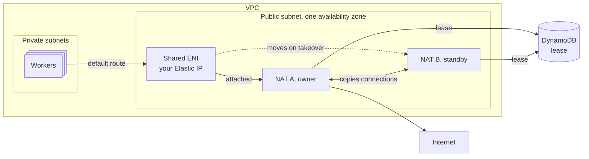

# natpair

A highly available NAT for AWS VPCs, built from two EC2 instances. It
costs a flat amount per month instead of AWS NAT Gateway's per-GB charge, and
it fails over in seconds while keeping open TCP connections.

- **One stable public IP.** Traffic leaves from one Elastic IP that you own,
  through every failover, so allowlists keep working.
- **Fast, safe failover.** The standby takes over about 16 s after the owner
  crashes. A planned handover pauses traffic for about 10 s. The two NATs
  never forward at the same time.
- **Connections survive.** The standby keeps a copy of every TCP connection,
  so established connections carry on after a takeover.

natpair is a daemon that runs on two stock Amazon Linux 2023 instances, plus a
Terraform module that deploys the whole pair. Versions before 1.0 may change
the module's inputs, so read the [changelog](CHANGELOG.md) before you upgrade.

## Should you use it?

Use natpair if:

- your private subnets send more than about 850 GB a month to the internet,
  so NAT Gateway's $0.045 per GB adds up,
- you need failover without a person in the loop, and
- you can run two EC2 instances and read their logs when something goes wrong.

Use NAT Gateway instead if:

- your traffic is under about 850 GB a month, or under 1.7 TB if you need
  the larger instances (see [Cost](#cost)),
- you need IPv6 egress, or UDP connections that survive a failover, or
- you don't want to run instances at all.

## Cost

Monthly cost in us-east-1 for one availability zone, using on-demand prices
from November 2026 and 730 hours a month. Prices differ by region, so check
the [EC2](https://aws.amazon.com/ec2/pricing/on-demand/),
[VPC](https://aws.amazon.com/vpc/pricing/) and
[DynamoDB](https://aws.amazon.com/dynamodb/pricing/on-demand/) pricing pages
for yours.

| | natpair, 2 × c7g.medium | natpair, 2 × c7gn.medium | NAT Gateway |
| --- | ---: | ---: | ---: |
| Instances or gateway hours | $53.00 | $91.10 | $32.85 |
| Public IPv4 addresses | $10.95 (3) | $10.95 (3) | $3.65 (1) |
| EBS, 2 × 8 GB gp3 | $1.28 | $1.28 | |
| DynamoDB lease table | about $9 | about $9 | |
| Lambda probe receiver | under $1 | under $1 | |
| **Fixed total** | **about $75** | **about $113** | **$36.50** |
| Per GB processed | $0 | $0 | $0.045 |
| **Cheaper than NAT Gateway above** | about 850 GB | about 1.7 TB | |

Data transfer out to the internet costs the same either way and isn't
included. The DynamoDB figure is measured on a running pair. Like a NAT
Gateway, a pair lives in one availability zone, so workers in other zones pay
AWS's cross-zone data charge, $0.01 per GB in each direction, to use it.

Pick the instance type by its baseline bandwidth. The "up to" figure is a
burst that doesn't last. AWS also caps traffic to the internet at 5 Gbps for
instances with fewer than 32 vCPUs, whatever their bandwidth. Only one NAT
forwards at a time, so each must carry the whole load on its own. If you're
replacing a NAT Gateway, its peak `BytesOutToDestination` in CloudWatch tells
you the load.

| Instance type | Baseline bandwidth | Burst |
| --- | ---: | ---: |
| c7g.medium | 0.52 Gbps | 12.5 Gbps |
| c7gn.medium | 3.125 Gbps | 25 Gbps |
| c7gn.large | 6.25 Gbps | 30 Gbps |

## How it works



**Workers** are the instances and pods in your private subnets. Their default
route points at the **shared ENI**, a network interface that carries your
Elastic IP. The NAT holding the shared ENI, the **owner**, forwards their
traffic. The other NAT, the **standby**, keeps a copy of every connection.

1. The owner holds a lease in DynamoDB and renews it every 0.5 s.
2. If the lease goes 6 s without a renewal, the standby takes it, moves the
   shared ENI to itself and starts forwarding.
3. A kernel program on each NAT stops forwarding 4 s after that NAT's last
   renewal, even if the daemon has crashed or frozen. So two NATs never
   forward at once.
4. The owner sends a test upload to the internet every second. If its path
   breaks while the standby's path works, it hands over.

[How natpair works](docs/architecture.md) covers each part in detail.

## When something fails

Times are measured on AWS, except the broken path and the owner losing
DynamoDB, which are estimated from local tests plus the time AWS takes to move
an ENI.

| What fails | What happens | Traffic pause |
| --- | --- | --- |
| You run `natpair maintenance` on the owner | It hands over once the standby passes its checks. | about 10 s |
| A new release rolls out | The standby upgrades first. The owner hands over only after the standby has stayed ready on the new release for 2 minutes. | about 10 s |
| The owner crashes or freezes | The standby takes over after the 6 s lease wait. | about 16 s |
| The owner is stopped or terminated without a handover | EC2 lets go of the shared ENI only once the instance has stopped, so the standby forces it off. | 25 to 35 s |
| The owner's internet path breaks | The owner hands over once the standby proves its own path works. | about 15 s |
| The owner's path loses some packets but still carries others | The owner keeps serving, as for more traffic than it can forward below, even if the loss is the owner's alone, such as a fault in its host. Run `natpair maintenance` on it to hand over. | none, while packets are lost |
| The owner gets more traffic than it can forward | The owner keeps serving while its path still carries some packets, because the standby would get the same traffic. Packets beyond what it can forward are lost. | none |
| The standby fails | Nothing moves. The pair has no standby until it recovers or you replace it. | none |
| The internet path breaks for both NATs | Nothing moves, since moving wouldn't help. | none |
| The probe receiver is down | Nothing moves. If the owner also crashes, the standby still takes over, about 2 s later than usual. | none |
| DynamoDB is unreachable from both NATs | The owner keeps forwarding. Nobody can take over until DynamoDB is back. | none |
| DynamoDB is unreachable from the owner only | The owner keeps forwarding while the standby waits out the 6 s lease, takes it and moves the shared ENI. | about 10 s |
| Only worker traffic breaks, while the NATs' own uploads work | natpair can't see this. Run an egress check from the workers, as in [Monitoring](docs/operations.md#monitoring). | until you act |

After a takeover, TCP connections the new owner has a copy of carry on. A TCP
connection it doesn't know, such as one opened just before the failure, gets a
reset, so the client reconnects at once instead of waiting for a timeout.

## Quick start

You need:

- a VPC with a public subnet whose route table sends `0.0.0.0/0` to an
  internet gateway,
- private subnets whose route tables you can point at the pair,
- Terraform 1.6 or later with the AWS provider 6.x, and
- permission to create the [resources the module creates](terraform/README.md#resources),
  including `iam:PassRole` for the NATs' role.

If your private subnets use a NAT Gateway today, follow
[Move from a NAT Gateway](docs/operations.md#move-from-a-nat-gateway)
instead.

1. Pick a release on the
   [releases page](https://github.com/artie-labs/natpair/releases) and get the
   SHA-256 of its `natpair_linux_arm64.tar.gz`:

   ```sh
   curl -sL https://github.com/artie-labs/natpair/releases/download/v0.1.1/checksums.txt | grep linux_arm64
   ```

2. Add the module, and point each private route table's default route at the
   shared ENI:

   ```hcl
   resource "aws_eip" "nat" {
     domain = "vpc"
   }

   module "natpair" {
     source = "git::https://github.com/artie-labs/natpair.git//terraform?ref=v0.1.1"

     name    = "natpair"
     pair_id = "natpair"

     public_subnet_id         = "subnet-0123456789abcdef0"
     public_route_table_id    = "rtb-0123456789abcdef0"
     shared_eip_allocation_id = aws_eip.nat.allocation_id

     instance_type = "c7gn.medium"

     release        = "v0.1.1"
     release_sha256 = "<64 hex digits from checksums.txt>"
   }

   resource "aws_route" "private_default" {
     route_table_id         = "rtb-0fedcba9876543210"
     destination_cidr_block = "0.0.0.0/0"
     network_interface_id   = module.natpair.shared_eni_id
   }
   ```

   Keep the Elastic IP outside the module, as here, so it outlives the pair.
   The NATs forward traffic from anywhere in the VPC, so any subnet you route
   to the shared ENI works. Set `worker_cidrs` to narrow that.

3. Run `terraform apply`. Each NAT installs natpair at first boot and reboots
   into it. Workers routed to the pair can't reach the internet until one NAT
   logs `forwarding open`. To avoid that gap, apply without the routes first,
   wait for `forwarding open`, then add them.

4. Check the pair, as in [Verify a new pair](docs/operations.md#verify-a-new-pair).

[`examples/`](examples) has a minimal and a complete configuration.
[`terraform/README.md`](terraform/README.md) lists every input and output.

## Limitations

- **One availability zone per pair.** An ENI can't move between zones, so both
  NATs live in the public subnet's zone. For a pair in each zone, give each
  pair a different `name` and `pair_id`, and see the DynamoDB endpoint below.
- **Only TCP over IPv4 survives a takeover.** UDP and ICMP are forwarded but
  not copied, so they start over. natpair doesn't forward IPv6.
- **arm64 only.** The NATs run Graviton instance types. Releases also include
  an amd64 build, which is for local testing.
- **About 64,000 connections per destination.** All worker traffic shares one
  public IP, so it can hold about 64,000 connections at once to the same
  destination address, port and protocol, much like a NAT Gateway.
- **A DynamoDB gateway endpoint on the public route table.** The module adds
  one, so the lease doesn't depend on the path the NATs forward. Other
  DynamoDB traffic from the public subnet uses it too. A route table can use
  only one DynamoDB gateway endpoint, so if yours already has one, or a second
  pair shares the table, set `create_dynamodb_endpoint = false`.
- **Some changes need new NATs.** Running NATs keep the image and
  configuration they got at first boot, and a new instance type restarts
  them. Change one NAT per apply, as in
  [Replace a NAT](docs/operations.md#replace-a-nat).

## Documentation

- [How natpair works](docs/architecture.md), including
  [security](docs/architecture.md#security)
- [Operations](docs/operations.md): verify, maintain, upgrade, replace and
  monitor a pair
- [Troubleshooting](docs/troubleshooting.md): what each warning means and
  what to do about it
- [Local fault tests](docs/local-campaign/README.md): the failures natpair is
  tested against, with results
- [Terraform module reference](terraform/README.md)

## Contributing and security

See [CONTRIBUTING.md](CONTRIBUTING.md) to build and test natpair. Report
security problems privately, as [SECURITY.md](SECURITY.md) describes.

## License

[MIT](LICENSE)
