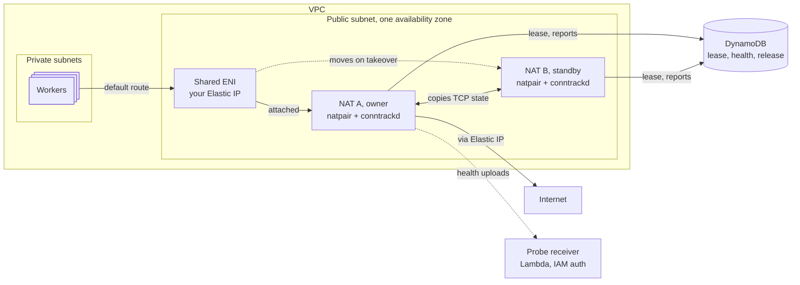
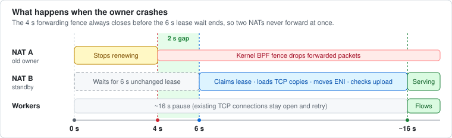
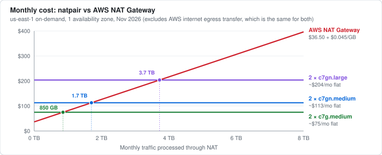

# natpair

High-availability NAT for AWS VPCs, built from two Amazon Linux 2023 EC2
instances for a flat monthly cost instead of AWS NAT Gateway's $0.045/GB charge.

Private subnets route their internet traffic to one shared network interface
(ENI) that carries your Elastic IP, so allowlists keep working through every
failover. One NAT (the owner) holds the shared ENI and forwards traffic. The
other (the standby) keeps a live copy of every TCP connection. If the owner
fails, the standby moves the ENI to itself in seconds, and open TCP connections
keep working.

**Status:** pre-1.0 (latest release:
[v0.2.0](https://github.com/artie-labs/natpair/releases/tag/v0.2.0)). Module
inputs may still change, so check [CHANGELOG.md](CHANGELOG.md) before
upgrading. Passes unit tests, privileged kernel tests and the 17-case
[local fault campaign](docs/local-campaign/README.md).

## Architecture



[How natpair works](docs/architecture.md) covers each component, networking
rules and the security model in detail.

## How it works

- **Lease.** The owner renews a DynamoDB record every 0.5 s with a conditional
  write. Each renewal lets it forward for 4 s. The standby may take the lease
  only after the record stays unchanged for 6 s, or at once if the owner
  released it.
- **Fence.** A small BPF (Berkeley Packet Filter) program in the kernel drops
  worker traffic once the owner's 4 s window expires, even if the daemon
  crashes or freezes. Two NATs never forward at the same time.
- **Connection copies.** `conntrackd` (the Linux connection-tracking daemon)
  copies the owner's IPv4 TCP connection table to the standby over their
  private interfaces. Unknown connections on a new owner get a TCP reset so
  clients reconnect at once instead of hanging.
- **Health checks.** Every 1 s, the owner sends a 4 KiB HTTPS upload through
  the shared Elastic IP, and the Lambda probe receiver echoes it back to test
  full-size packets both ways. Every 5 s, the standby tests its own path and
  checks that its copy holds the owner's 16 oldest connections and at least 95%
  of the table. The owner steps down after 2 failed rounds only if the standby
  proved its own path.
- **Takeover.** The standby loads the copied connections, moves the shared ENI
  to itself (forcing detach after 15 s if stuck), verifies an upload through
  the shared Elastic IP, and opens its fence.

<picture>
  <source media="(prefers-color-scheme: dark)" srcset="docs/images/failover-dark.svg">
  <source media="(prefers-color-scheme: light)" srcset="docs/images/failover-light.svg">
  
</picture>

## When something fails

Pause times are measured on AWS, except broken path and owner-only DynamoDB
loss, which combine local test timings with AWS ENI move time.

| Failure | What happens | Traffic pause |
| --- | --- | --- |
| `natpair maintenance` on owner | Hands over once standby passes its checks. | ~10 s |
| New release pinned | Standby upgrades first. Owner hands over after standby stays ready for 2 min. | ~10 s |
| Owner crashes or freezes | Fence closes within 4 s. Standby claims lease at 6 s and moves ENI. | ~16 s |
| Owner stopped or terminated directly | EC2 holds ENI until instance stops, so standby forces detach after 15 s. | 25 to 35 s |
| Owner's internet path breaks | Owner steps down after 2 failed probes once standby proves its own path. If both break, nothing moves. | ~15 s |
| Owner overloaded or congested | Keeps serving while TCP handshakes still pass. Hands over at most once per 10 min if at least half of rounds are congested or failed. | none, or ~10 s per 10 min |
| Standby fails | Owner keeps serving with no failover until standby recovers or is replaced. | none |
| Probe receiver down | Nothing moves. If owner also crashes, standby takes over as a last resort (~2 s later than usual). | none |
| DynamoDB unreachable | Both NATs: owner keeps serving, no takeover until back. Owner only: standby takes over at 6 s. | none / ~10 s |
| Only worker traffic breaks | natpair can't see this because its own uploads still pass. Run a [worker egress check](docs/operations.md#monitoring). | until you act |

**Limits:** one availability zone per pair (an ENI can't cross zones), only TCP
over IPv4 survives a takeover (UDP and ICMP start over, no IPv6), arm64
(Graviton) only, 59,976 TCP source ports per destination IP and port (warns at
70%), and one DynamoDB gateway endpoint per public route table (set
`create_dynamodb_endpoint = false` if one already exists).

## Cost and sizing

<picture>
  <source media="(prefers-color-scheme: dark)" srcset="docs/images/cost-dark.svg">
  <source media="(prefers-color-scheme: light)" srcset="docs/images/cost-light.svg">
  
</picture>

| Option | vCPUs | Baseline (burst) | Monthly fixed | Per GB | Cheaper than NAT Gateway above |
| --- | ---: | ---: | ---: | ---: | ---: |
| AWS NAT Gateway | | | $36.50 | $0.045 | |
| natpair, 2 × `c7g.medium` | 1 | 0.52 Gbps (12.5) | ~$75 | $0 | ~850 GB |
| natpair, 2 × `c7gn.medium` | 1 | 3.125 Gbps (25) | ~$113 | $0 | ~1.7 TB |
| natpair, 2 × `c7gn.large` | 2 | 6.25 Gbps (30) | ~$204 | $0 | ~3.7 TB |

Prices are us-east-1 on-demand (November 2026, 730 h/mo). Each natpair total
includes 2 instances ($53.00 / $91.10 / $182.21), 3 public IPv4 addresses (one
per NAT plus the shared Elastic IP, $10.95 vs $3.65 for NAT Gateway), 2 × 8 GB
gp3 EBS ($1.28), DynamoDB (~$9 measured) and Lambda (<$1). Internet egress data
transfer costs the same either way. Workers in other availability zones pay
AWS's $0.01/GB cross-zone charge each way, just like NAT Gateway.

Size by **baseline bandwidth** because one NAT carries the entire load at a
time, and AWS caps internet egress at 5 Gbps on instances with fewer than 32
vCPUs. A 1-vCPU instance (`c7g.medium` or `c7gn.medium`) handles normal traffic,
but small-packet floods above ~500k to 600k packets/s can starve its lease
renewals. Pick a 2-vCPU `c7gn.large` if the pair must ride out floods (tested
at 800k to 1.2M 64-byte UDP packets/s without handing over).

## Deploy

Requires Terraform >= 1.6 with the AWS provider 6.x, a VPC with a public subnet
and private route tables, and IAM permission to create the
[module's resources](terraform/README.md#resources) (including `iam:PassRole`).
Migrating from NAT Gateway? Follow
[Move from a NAT Gateway](docs/operations.md#move-from-a-nat-gateway) instead.

1. Get the SHA-256 of `natpair_linux_arm64.tar.gz` for the
   [release](https://github.com/artie-labs/natpair/releases):

   ```sh
   curl -sL https://github.com/artie-labs/natpair/releases/download/v0.2.0/checksums.txt | grep linux_arm64
   ```

2. Add the [`terraform/`](terraform) module and point private route tables at
   `module.natpair.shared_eni_id` (keep the Elastic IP outside the module so it
   outlives the pair):

   ```hcl
   resource "aws_eip" "nat" {
     domain = "vpc"
   }

   module "natpair" {
     source = "git::https://github.com/artie-labs/natpair.git//terraform?ref=v0.2.0"

     name                     = "natpair"
     pair_id                  = "natpair"
     public_subnet_id         = "subnet-0123456789abcdef0"
     public_route_table_id    = "rtb-0123456789abcdef0"
     shared_eip_allocation_id = aws_eip.nat.allocation_id
     instance_type            = "c7gn.medium"
     release                  = "v0.2.0"
     release_sha256           = "<64 hex digits from checksums.txt>"
   }

   resource "aws_route" "private_default" {
     route_table_id         = "rtb-0fedcba9876543210"
     destination_cidr_block = "0.0.0.0/0"
     network_interface_id   = module.natpair.shared_eni_id
   }
   ```

   See [`examples/minimal`](examples/minimal),
   [`examples/complete`](examples/complete) and
   [`terraform/README.md`](terraform/README.md) for all inputs and outputs.

3. Run `terraform apply`. Each NAT installs natpair at first boot and reboots
   into it. To avoid a startup gap, apply without the private routes first,
   wait for one NAT to log `forwarding open`, then add them.
4. [Verify the pair](docs/operations.md#verify-a-new-pair) and set up a
   [worker egress check](docs/operations.md#monitoring) that alerts when worker
   traffic fails or leaves from the wrong IP.

## Maintenance

Run `sudo natpair maintenance` on the owner (via AWS Session Manager, no SSH)
before rebooting, stopping or replacing it. Wait for the standby to log
`forwarding open`, do your work, then run `sudo natpair resume` on a rebooted
or restarted NAT.

To upgrade, update `?ref=`, `release` and `release_sha256` together and run
`terraform apply`. The NATs roll through the pinned release one at a time,
standby first. Changes to boot-time inputs (`worker_cidrs`, `max_connections`,
`kernel`, Datadog) require replacing one NAT per apply, standby first.

See [Operations](docs/operations.md) for runbooks and alerts, and
[Troubleshooting](docs/troubleshooting.md) for every warning message.

## Development

```sh
make test             # unit tests with race detector
make test-privileged  # iptables, network namespace and BPF tests in Docker
make test-campaign    # 17-case local fault campaign in Docker
make lint             # golangci-lint (run make generate first)
make build            # linux/arm64 and linux/amd64 binaries in bin/
```

The daemon lives in `cmd/natpair/` and `internal/`, systemd and install files
in `deploy/`, the Terraform module in `terraform/`, and the fault campaign in
`test/campaign/`. See [CONTRIBUTING.md](CONTRIBUTING.md),
[SECURITY.md](SECURITY.md) and [LICENSE](LICENSE) (MIT).
