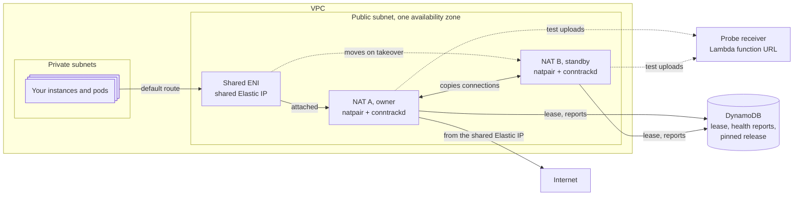

# How natpair works

natpair is two NAT instances, A and B, in one public subnet. Private subnets
route their internet traffic to a third network interface, the **shared ENI**,
which carries the pair's Elastic IP. Whichever NAT holds the shared ENI
forwards. That NAT is the **owner**. The other is the **standby**.



The Terraform module in [`terraform/`](../terraform) creates all of it: both
NATs, the shared ENI and its Elastic IP association, the DynamoDB table, the
NATs' IAM role, the probe receiver and a DynamoDB gateway endpoint. You point
the private subnets' default routes at the shared ENI.

## Who owns the shared ENI: the lease

One DynamoDB item, the lease, records the owner.

- The owner renews the lease every 0.5 s with a conditional write. Each
  successful renewal lets it forward for the next 4 s.
- The standby may take the lease only after the item has stayed unchanged for
  6 s. Because 6 s is longer than 4 s, the old owner has always stopped
  forwarding before the standby starts.
- An owner that stops on purpose releases the lease, so the standby takes over
  on its next check instead of waiting 6 s.

## Stopping a NAT that can't renew: the fence

A small BPF program in the kernel checks every forwarded packet against the
end of the owner's current 4 s. After that, the kernel drops private-subnet
traffic, even if the natpair daemon has crashed, hung or been killed. So two
NATs never forward at the same time, and a frozen owner can't keep traffic
going to the wrong place.

## Keeping connections across a takeover: conntrackd

Each NAT runs conntrackd, which copies the owner's connection table to the
standby as connections open and close. When the standby takes over, it loads
those copies, so established TCP connections keep their source address and
port and carry on. Only TCP over IPv4 is copied. The copies always travel
between the NATs' own interfaces and addresses, never through the shared
ENI.

A connection the new owner doesn't know gets a TCP reset instead of silence,
so the client reconnects at once rather than waiting for its own timeout.

## Checking the path: probes

The daemon checks that traffic actually gets out, not just that the instance
is up.

- **The owner** uploads 4 KiB over HTTPS through the shared Elastic IP every
  second. The probe receiver, a Lambda function URL that requires IAM
  authentication, sends the upload back, so large packets are tested in both
  directions.
- **The standby** checks its own path every 5 s through its own Elastic IP,
  and checks that its copy of the connection table holds the owner's recent
  probe connections and the owner's 16 oldest connections.
- Each NAT writes a short report to DynamoDB after every round, so the peer
  can see it.

An owner steps down after two failed rounds, but only once the standby has
proved its own path. So a failure that affects both, such as the receiver
being down, never makes a healthy owner step down. If the owner also crashes
during such a failure, the standby still takes over, about 2 s later than
usual.

A round whose upload failed while the NAT's connection table was full
doesn't count as failed. The kernel dropped the upload's new connection, as
it drops new worker connections, and the standby would load the same copied
table on taking over and fail the same way. Full means the kernel dropped
packets it couldn't track since the last round while the table was at least
90% full.

## Taking over

When the standby takes the lease, it:

1. loads the copied connections,
2. moves the shared ENI to itself, forcing the detach after 15 s if the old
   owner doesn't let go,
3. checks an upload through the shared Elastic IP,
4. and only then opens its fence and starts forwarding.

## Upgrading itself

The pinned release lives in the same DynamoDB table. Every minute each NAT
compares it with the release it runs.

1. The standby downloads the pinned release, checks its SHA-256, installs it
   and reboots into it. It does this only while the owner serves with a
   working path.
2. Once the standby has run the new release and stayed ready for 2 minutes,
   the owner hands over, as in planned maintenance.
3. The old owner, now the standby, installs the release and reboots.

A release that never gets ready stays on the standby, so traffic stays on the
old release. See [operations](operations.md#upgrade) for the steps.

## Pacing forwarded traffic

Pacing is optional and off by default. Turn it on with the module's
`pacing` input, as in [operations](operations.md#pace-forwarded-traffic).

AWS limits each instance's bandwidth in each direction and its packets per
second. Above a limit, the hypervisor drops packets at random from every
flow. That includes the lease renewals and connection copies the pair
depends on, so one worker sending too much can slow every worker and put the
lease at risk. With pacing on, the NAT keeps forwarded traffic just under
the limits itself. A worker that sends too much slows to its fair share, and
the others barely notice.

**Which packets.** Uploads, from workers to the internet, leave through the
shared ENI. Downloads, from the internet to workers, leave through the NAT's
own interface, because only traffic from the worker CIDRs uses the shared
ENI's route table. AWS counts both against the same limits, so both are
paced against one budget. A small BPF program on every interface copies each
arriving packet's source address into its mark. A packet the NAT sends
itself has no mark, so lease renewals, probes, conntrackd's copies and AWS
API calls are never paced. The mark also tells which worker sent an upload
after source NAT has replaced its address.

**How a packet waits.** A second BPF program, on packets leaving, gives each
forwarded worker packet a departure time, and `sch_fq` holds it until then.
This is the earliest departure time model that Cilium's bandwidth manager
uses. Each interface gets one `sch_fq` per transmit queue under `mq`, so CPUs
don't share a qdisc lock. A packet that would have to wait more than 20 ms
is dropped instead. That tells the sender to slow down and keeps the queues
short.

**Fair shares.** Each worker address has its own token bucket, in bytes and
in packets, and all traffic shares one more. Four times a second the daemon
looks at which workers had packets wait more than 1 ms. Workers that didn't
keep what they use, and those that did split the rest of the cap equally.
Below the cap, no worker waits. A packet that its worker's bucket delayed
skips the shared bucket, so a heavy worker's queue never holds up the
others. With the AWS VPC CNI, each pod has its own address, so each pod is
its own worker.

**Finding the cap.** The daemon reads the ENA driver's allowance counters,
`bw_in_allowance_exceeded`, `bw_out_allowance_exceeded` and
`pps_allowance_exceeded`, every 10 ms by default, on every interface. ENA
refreshes them at least every millisecond. AWS counts the whole instance, and
when it drops, it drops on both ENIs: on AWS, after a c7gn.medium's burst ran
out, its own ENI lost 40% of the acknowledgements going back to workers.
Bandwidth and packet rate each have their own cap:

- Until a counter first moves, there is no cap, unless you set a start.
  While the counters stay still and traffic presses a cap, it rises by 5% a
  second.
- When a counter moves, the cap drops to 80% of the rate forwarded at the
  time, and the NAT remembers that rate. If the counters keep moving after
  the cut, the next cut is to 50%.
- The cap then climbs back to 95% of the remembered rate in 3 s. 10 s after
  the cut, and only while traffic presses it, it rises again by 5% a second
  to check whether the limit went up, as it does when burst credits refill.
  The counters show a drop within one poll, so a probe that finds the same
  limit goes about 0.05% over it and costs one cut.
- When burst credits run out and the limit falls to the instance's baseline,
  the counters move again and the cap follows it down. On a c7gn.medium the
  limit fell from 8.35 to 3.1 Gbps. Replayed in a test, the cap is under
  3.1 Gbps within 100 ms.

AWS doesn't always count. Once, when a c7gn.medium's burst ran out, its
traffic fell from 6.25 to 3.1 Gbps with no counter moving on any host.
Pacing can't see that, so the caps stay where they were and AWS's own limit
applies.

After a cut, the cap ignores the counters for 50 ms, while packets already
queued under the old cap leave.

A cap only cuts when forwarded traffic is to blame. It must make up at
least half of what AWS counts against that allowance: bytes sent, for
bandwidth, and packets sent and received, for packet rate. And if a cut
forwards less but AWS keeps dropping at the same rate, the cap goes back to
where it was and stops cutting until the drops stop. Otherwise traffic the
NAT can't pace, such as its own, would push the workers' caps down for
nothing.

A NAT can start from a configured cap, or with no cap until the counters
first move. A cut never takes a cap below 100 Mbit/s or 100,000 packets a
second, because counters that move while forwarded traffic is lower than that
come from other traffic.

**The CPUs' limit.** A NAT forwards in the kernel, on the CPUs that take the
network interrupts, at about 1.1 µs a full-size packet and 1.6 µs a small
one. One CPU runs out at about 600,000 small packets a second, long before
AWS's packet rate allowance. A NAT whose CPU is full can't renew its lease,
resolve DNS or probe its path, so it steps down, and the standby inherits
the same load. So the daemon also caps forwarded packets a second by CPU,
starting with no cap.

- Every 100 ms it reads `/proc/stat`, and judges the average of the last
  three readings. `/proc/stat` counts in hundredths of a second, so one
  reading can be off by a tenth.
- When the busiest CPU averages more than 80% busy, or one reading shows it
  full, the cap drops to 80% of the rate forwarded at the time. A flood of
  small packets is cut at the end of the first 100 ms it fills a CPU. A cut
  that wasn't enough is followed by another 300 ms later.
- While the busiest CPU averages under 70% and traffic presses the cap, it
  rises by 10% a second. From 70% to 80% it stays. So the cap settles where
  the CPU has a little room, whatever the packet size, and climbs back as
  soon as the load that caused a cut is gone.

It cuts only when forwarding is to blame: forwarded traffic is at the cap,
and at 1.6 µs a packet it explains at least half of the load. If a cut
forwards less but the CPU stays as busy, as when conntrackd or traffic that
senders keep offering fills it, the cap goes back to where it was and stops
cutting until the CPU calms down. It never goes below 250,000 packets a
second per CPU. The packet cap in force is the lower of the two. Pacing
delays and drops packets on the way out, so it bounds incoming traffic only
as TCP senders slow down.

**Takeovers.** Pacing runs on its own and nothing waits for it, so it can't
delay or stop a takeover, and forwarding works if it fails to load. Both
NATs pace their own interface all the time. A new owner paces the shared ENI
within a second of the ENI appearing. Each NAT keeps its caps in memory and
starts again from the configured values when its daemon restarts, or when
`natpair pacing-on` turns pacing back on. If no
daemon renews the limits for 10 s, the kernel stops pacing, so a NAT whose
daemon is gone, or runs a release without pacing, forwards unpaced.

## Network details

- Both NATs and the shared ENI must be in one availability zone, because an
  ENI can't move between zones.
- The NATs' security group allows all traffic from the VPC's CIDRs, and all
  TCP and UDP ports from anywhere. With every port open, AWS doesn't track
  connections through the NATs. That matters because after a takeover, the
  replies to copied connections arrive at the other instance, and AWS would
  drop replies it tracked on the old one.
- So the host firewall on each NAT is what filters traffic to the NAT itself.
  It accepts new connections only from the VPC and the peer, and drops
  everything else from outside the VPC without an answer. Traffic the NAT
  forwards doesn't pass through it.
- The NAT's own connections skip the kernel's connection table, so when
  worker connections fill it, the NAT's DNS lookups, lease renewals, AWS API
  calls and connection copies still work. The own-path probes still use the
  table, because they test the forwarding path, which needs it.
  [Security](#security) lists exactly what skips it.
- The module adds a DynamoDB gateway endpoint to the public route table, so
  lease renewals and health reports reach DynamoDB without depending on the
  internet path the NATs forward. Workers' DynamoDB traffic goes through the
  NATs like their other traffic, so it leaves from the shared Elastic IP.
- A NAT forwards on the CPU that took each network queue's interrupt. natpair
  puts queue n of every ENI on CPU n, checks again every 5 s, which catches
  the shared ENI after a takeover, and turns irqbalance off. Otherwise
  irqbalance can put all of an ENI's queues on one CPU, and a two-CPU NAT
  forwards with only one of them.
- By default the NATs forward traffic from every CIDR of the VPC. Their own
  traffic, such as AWS API calls and lease renewals, always keeps their own
  address and route, even though that address is inside the VPC.

## Security

- **Access.** The NATs run no SSH server. Open a shell with Session Manager.
  Instance metadata requires IMDSv2.
- **Permissions.** Each NAT's IAM role can change only its own pair's lease
  records and move only its own pair's shared ENI.
  [The module reference](../terraform/README.md#what-the-nats-may-do) lists
  every permission.
- **Connection copies.** conntrackd sends connection state to the peer in
  cleartext over UDP port 3780. The host firewall accepts it only from inside
  the VPC.
- **Host firewall.** It accepts new connections to the NAT only from the VPC
  and the peer, which get the kernel's usual reset from a closed port. From
  outside the VPC, it drops everything without an answer, on every port of
  the NAT's own and shared addresses. The one exception is TCP without SYN
  to the shared address that matches no connection the NAT tracks. It gets
  a reset, so a remote server still sending on a connection the new owner
  never copied closes it at once, instead of waiting for its own timeout.
  A scan of the NAT's own address learns nothing, and a scan of the shared
  address learns only that it answers such packets. Forwarded traffic
  doesn't pass through the firewall.
- **Untracked connections.** These skip the connection table, both ways:
  TCP on the NAT's own ephemeral ports (32768 to 60999), UDP between those
  ports and the VPC, the peer's copies to port 3780, and UDP with Amazon Time
  Sync (169.254.169.123, port 123) and the Route 53 Resolver
  (169.254.169.253, port 53). Without state, the firewall accepts only their
  replies:
  - TCP without SYN, to the NAT's own address and ephemeral ports, that
    belongs to one of the NAT's sockets. Such a packet can't open a
    connection. The kernel finds the socket by the packet's addresses and
    ports, which needs no connection tracking, and ignores sockets
    listening on any address. Other TCP to those ports is dropped like any
    other port's.
  - UDP from those two link-local services, from their port to the NAT's
    ephemeral ports. Nothing outside the instance can send from a
    link-local address.
  - ICMP fragmentation-needed, host-unreachable, port-unreachable and
    time-exceeded messages to the NAT's own address, limited to 50 a
    second. Errors about tracked connections are accepted as before.
  The NAT's own sockets keep to the ephemeral range, and the own-path probes
  use ports 61000 to 65535, which stay tracked.
- **Forged ICMP errors.** Anyone can send the NAT ICMP errors that name one
  of its connections. Linux acts on one only if it matches a socket's
  addresses and ports. For TCP, its sequence number must also fall inside
  the connection's unacknowledged data, which an attacker who can't see the
  traffic has to guess. A forged fragmentation-needed message can lower
  the path MTU no further than 552 bytes, which slows a connection but
  doesn't break it. On an established TCP connection, Linux records an
  unreachable message only as a soft error, which ends the connection only
  if it is already timing out. While a connection is being set up, a forged
  one that matches can abort it, and the caller tries again. A forged
  port-unreachable that matches a DNS lookup's random port fails that
  lookup, which is retried. The rate limit bounds all of it.
- **Pacing.** The pace program keeps state for at most 65,536 workers, and
  forgets the least recently seen one first. The NAT's own traffic never
  has state there. A packet gets a worker's state only if it arrived on an
  interface, so the mark program marked it with its source address, and
  that mark, or else its destination, is in the worker CIDRs. Traffic from
  the internet is only forwarded as replies on a worker's own connections,
  so it can't create or drain another worker's state. A worker that can
  send from other workers' addresses can use up their fair shares. AWS stops
  that unless an instance turns off its source and destination check, or
  several pods share one node's addresses.
- **Encryption at rest.** The lease table uses DynamoDB's AWS owned key. The
  root volumes are encrypted with the account's default EBS key, AWS managed
  `aws/ebs` unless you've set another, so whoever launches the NATs needs
  permission to use that key through EC2.
- **Releases.** A NAT installs a release only if its SHA-256 matches
  `release_sha256`. Each release's files carry a GitHub build provenance
  attestation. To check one:

  ```sh
  gh attestation verify natpair_linux_arm64.tar.gz --repo artie-labs/natpair
  ```
